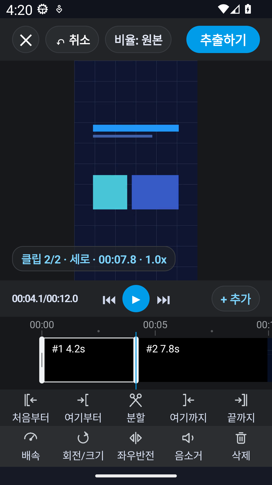
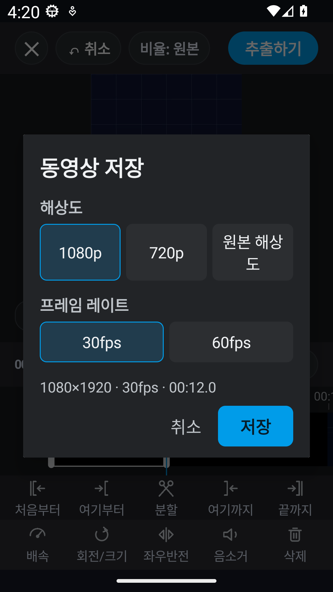

# 퀵컷 · QikCut

퀵컷은 긴 레슨 영상이나 일상 영상에서 필요한 구간을 골라 MP4로 저장하는 Android 편집기입니다. 편집은 기기에서 이루어지며, 편집본은 원본과 별도 파일로 저장됩니다.

QikCut is an on-device Android video editor for trimming, splitting and joining clips.

## 주요 기능

- 날짜별 영상 목록과 Android 파일 선택창에서 영상을 하나 또는 여러 개 가져옵니다.
- 두 손가락으로 타임라인을 확대·축소하고 중앙 재생선에 맞춰 영상을 자르거나 분할합니다.
- 클립마다 배속, 음소거, 회전, 크기, 좌우반전을 조절합니다.
- 원본 비율이나 9:16 등 원하는 화면 비율과 해상도 및 프레임 레이트 옵션으로 MP4를 저장합니다.
- 저장 완료 화면에서 결과 영상을 열거나 Android 공유 메뉴로 보냅니다.

## 화면

<p>
  
  
</p>

## 빌드 및 테스트

Android Studio에서 프로젝트를 열거나 JDK 17과 Android SDK 36을 설치한 뒤 Gradle Wrapper를 실행합니다. 앱은 Android 10(API 29) 이상에서 실행됩니다. 편집 미리보기에는 Media3 ExoPlayer를, MP4 내보내기에는 Media3 Transformer를 사용합니다.

**Windows PowerShell**

```powershell
.\gradlew.bat :app:testDebugUnitTest :app:assembleDebug
```

**macOS / Linux**

```sh
sh ./gradlew :app:testDebugUnitTest :app:assembleDebug
```

- 디버그 APK는 `app/build/outputs/apk/debug/app-debug.apk`에 생성됩니다.
- Play에 등록된 앱 ID는 `com.photolab.quickvideo`입니다. 디버그 빌드는 `.debug`가 붙은 ID를 사용합니다.
- MP4는 갤러리의 `QuickVideo` 앨범에 저장됩니다. `원본 해상도`는 크기 설정이며, 저장본은 새로 인코딩됩니다.

## 개인정보처리방침

앱의 [개인정보처리방침](privacy-policy.md)에서 영상 접근 범위, 기기 내 처리, 저장 및 공유 방식을 확인할 수 있습니다.
